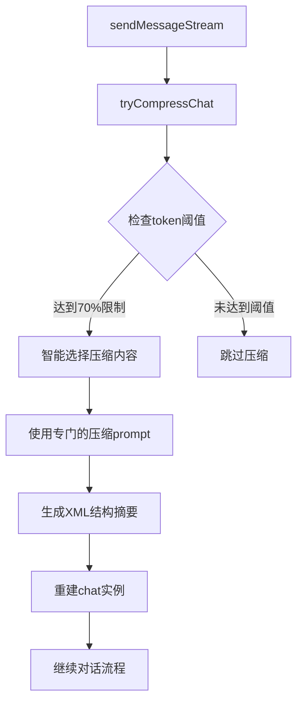

# 压缩功能对比分析：Gemini 原生 vs UniversalAIClient 实现

## 📋 概览

本文档对比分析了 Gemini CLI 原生压缩功能与新实现的 UniversalAIClient 多提供商压缩功能，展示两种方案的设计理念、技术实现和使用差异。

## 🔍 核心实现对比

### 1. **架构设计**

| 方面 | Gemini 原生 | UniversalAIClient |
|------|------------|-------------------|
| **定位** | Gemini 专用，深度集成 | 多提供商通用，适配器模式 |
| **历史存储** | `Content[]` (Gemini格式) | `CoreMessage[]` (标准格式) |
| **压缩触发** | 自动 + 手动 | 手动触发 |
| **API调用** | 直接 Gemini API | Vercel AI SDK |

### 2. **压缩阈值和策略**

#### Gemini 原生
```typescript
// 基于模型token限制的动态阈值
private readonly COMPRESSION_TOKEN_THRESHOLD = 0.7;
private readonly COMPRESSION_PRESERVE_THRESHOLD = 0.3;

// 触发条件：达到模型70%的token限制
if (!force && originalTokenCount < 
    this.COMPRESSION_TOKEN_THRESHOLD * tokenLimit(model)) {
  return null;
}
```

#### UniversalAIClient
```typescript
// 固定阈值策略
const COMPRESSION_THRESHOLD = 1000;
const MESSAGES_TO_KEEP = 2;

// 触发条件：超过1000 token且消息数 > 2
if (originalTokenCount < 1000 || this.messages.length <= 2) {
  return null;
}
```

### 3. **压缩内容选择**

#### Gemini 原生 - 智能分片策略
```typescript
// 按字符数比例计算压缩点
let compressBeforeIndex = findIndexAfterFraction(
  curatedHistory,
  1 - this.COMPRESSION_PRESERVE_THRESHOLD // 保留最新30%
);

// 找到下一个用户消息作为分割点
while (compressBeforeIndex < curatedHistory.length &&
       (curatedHistory[compressBeforeIndex]?.role === 'model' ||
        isFunctionResponse(curatedHistory[compressBeforeIndex]))) {
  compressBeforeIndex++;
}

const historyToCompress = curatedHistory.slice(0, compressBeforeIndex);
const historyToKeep = curatedHistory.slice(compressBeforeIndex);
```

#### UniversalAIClient - 简单保留策略  
```typescript
// 简单保留最后N条消息
const messagesToKeep = 2;
const messagesToCompress = this.messages.slice(0, -messagesToKeep);
const messagesKept = this.messages.slice(-messagesToKeep);
```

### 4. **压缩提示设计**

#### Gemini 原生 - 结构化XML总结
**系统提示**：专业的状态管理器角色
```
You are the component that summarizes internal chat history into a given structure.
When the conversation history grows too large, you will be invoked to distill 
the entire history into a concise, structured XML snapshot.
```

**输出格式**：复杂XML结构
```xml
<state_snapshot>
    <overall_goal>用户的高级目标</overall_goal>
    <key_knowledge>关键知识点</key_knowledge>
    <file_system_state>文件系统状态</file_system_state>
    <recent_actions>最近的操作</recent_actions>
    <current_plan>当前计划</current_plan>
</state_snapshot>
```

#### UniversalAIClient - 简单中文总结
**系统提示**：直接的总结任务
```
请将以下对话历史总结成一个简洁的摘要，保留关键信息和上下文：
${conversationHistory}
请用中文总结，格式为：
对话摘要：[总结内容]
```

**输出格式**：纯文本摘要
```
[对话历史摘要] 对话摘要：用户询问了关于...，我回答了...
```

### 5. **Token计算方式**

#### Gemini 原生
```typescript
// 使用官方API精确计算
const { totalTokens: originalTokenCount } = 
  await this.getContentGenerator().countTokens({
    model,
    contents: curatedHistory,
  });
```

#### UniversalAIClient
```typescript
// 基于字符数估算
getEstimatedTotalTokens(): number {
  const totalText = this.messages.map(msg => /* 提取文本内容 */).join(' ');
  return estimateTokenCount(totalText); // 字符数/4的简单估算
}
```

### 6. **压缩执行流程**

#### Gemini 原生流程


#### UniversalAIClient流程
```mermaid
graph TD
    A[/compress命令] --> B[tryCompressChat]
    B --> C{检查消息数和token数}
    C -->|>2消息且>1000token| D[保留最后2条消息]
    D --> E[使用中文总结prompt]
    E --> F[生成简单摘要]
    F --> G[替换消息历史]
    G --> H[返回压缩结果]
    C -->|条件不满足| I[返回null]
```

## 📊 功能特性对比

| 特性 | Gemini 原生 | UniversalAIClient | 说明 |
|------|------------|-------------------|------|
| **自动触发** | ✅ | ❌ | Gemini在对话流程中自动检查 |
| **手动触发** | ✅ | ✅ | 都支持/compress命令 |
| **多提供商** | ❌ | ✅ | UniversalAIClient支持所有提供商 |
| **精确token计算** | ✅ | ❌ | Gemini使用官方API，Universal使用估算 |
| **智能内容选择** | ✅ | ❌ | Gemini按比例选择，Universal简单保留 |
| **结构化输出** | ✅ | ❌ | Gemini生成XML结构，Universal纯文本 |
| **上下文保持** | ✅ | ✅ | 都保留最近的对话内容 |
| **工具调用支持** | ✅ | ✅ | 都能处理工具调用历史 |

## 🎯 压缩效果对比

### Token压缩率
- **Gemini 原生**：通常可达到60-80%的压缩率（基于XML结构化总结）
- **UniversalAIClient**：目标30%压缩率（maxTokens限制）

### 信息保留度
- **Gemini 原生**：高度结构化，保留详细的状态信息
- **UniversalAIClient**：简化总结，重点保留对话要点

### 性能表现
- **Gemini 原生**：集成在对话流程中，无额外延迟
- **UniversalAIClient**：需要额外API调用，有一定延迟

## 🔧 技术实现细节

### 错误处理

#### Gemini 原生
```typescript
// 完整的错误报告和重试机制
await reportError(error, 'Error in compression', history, 'compression-phase');
const result = await retryWithBackoff(apiCall, {
  onPersistent429: async (authType, error) => 
    await this.handleFlashFallback(authType, error)
});
```

#### UniversalAIClient
```typescript
// 简单的错误捕获和日志
try {
  // compression logic
} catch (error) {
  console.error('压缩聊天历史时出错:', error);
  return null;
}
```

### 配置灵活性

#### Gemini 原生
```typescript
// 硬编码的阈值，基于模型动态调整
private readonly COMPRESSION_TOKEN_THRESHOLD = 0.7;
private readonly COMPRESSION_PRESERVE_THRESHOLD = 0.3;
```

#### UniversalAIClient
```typescript
// 固定阈值，但可以通过代码修改
const originalTokenCount = this.getEstimatedTotalTokens();
if (originalTokenCount < 1000) return null;
```

## 📈 优缺点分析

### Gemini 原生压缩

**优点：**
- ✅ **自动化程度高**：集成在对话流程中，用户无感知
- ✅ **压缩质量高**：使用专门的提示和XML结构
- ✅ **智能内容选择**：基于对话完整性选择压缩点
- ✅ **精确token计算**：使用官方API获取准确统计
- ✅ **错误处理完善**：完整的重试和降级机制

**缺点：**
- ❌ **仅支持Gemini**：无法用于其他AI提供商
- ❌ **复杂度高**：需要理解XML结构和状态管理
- ❌ **定制性差**：压缩策略固定，难以调整

### UniversalAIClient压缩

**优点：**
- ✅ **多提供商支持**：适用于OpenAI、Anthropic、Google等
- ✅ **实现简单**：逻辑清晰，易于理解和维护
- ✅ **本地化友好**：中文提示和输出
- ✅ **定制性强**：容易调整阈值和策略
- ✅ **向后兼容**：保持与Gemini客户端一致的接口

**缺点：**
- ❌ **手动触发**：需要用户主动执行压缩命令
- ❌ **token估算不准确**：基于字符数的简单估算
- ❌ **压缩策略简单**：固定保留最后几条消息
- ❌ **信息结构化程度低**：纯文本总结，缺少结构

## 🚀 使用场景建议

### 适合Gemini原生压缩的场景
- 长时间的代码开发会话
- 需要维护复杂项目状态
- 对压缩质量要求很高
- 主要使用Gemini模型

### 适合UniversalAIClient压缩的场景
- 多提供商环境
- 简单的问答对话
- 需要自定义压缩策略
- 对中文支持有要求

## 💡 优化建议

### 对UniversalAIClient的改进建议

1. **智能阈值**：基于模型动态调整压缩阈值
```typescript
const modelLimit = getUniversalTokenLimit(this.config.provider, this.config.model);
const threshold = modelLimit * 0.7; // 动态阈值
```

2. **更好的内容选择**：参考Gemini的分片策略
```typescript
// 寻找对话的自然分割点
const splitPoint = findConversationBoundary(this.messages, preserveRatio);
```

3. **结构化输出**：可选的结构化压缩模式
```typescript
const compressionPrompt = useStructured ? 
  getStructuredCompressionPrompt() : 
  getSimpleCompressionPrompt();
```

4. **自动触发**：集成到对话流程中
```typescript
// 在generateWithToolsUsingMessages中检查压缩需求
if (this.shouldCompress()) {
  await this.tryCompressChat(promptId, false);
}
```

## 📝 总结

两种压缩实现各有优势：

- **Gemini原生压缩**适合专业开发场景，提供高质量的自动压缩
- **UniversalAIClient压缩**适合多样化使用场景，提供灵活的多提供商支持

在多提供商架构下，UniversalAIClient的压缩实现是必要的补充，虽然在某些方面不如原生实现精细，但为用户提供了更广泛的选择和更好的兼容性。

通过持续优化，可以将两种方案的优点结合起来，实现既支持多提供商又具备高质量压缩的理想解决方案。